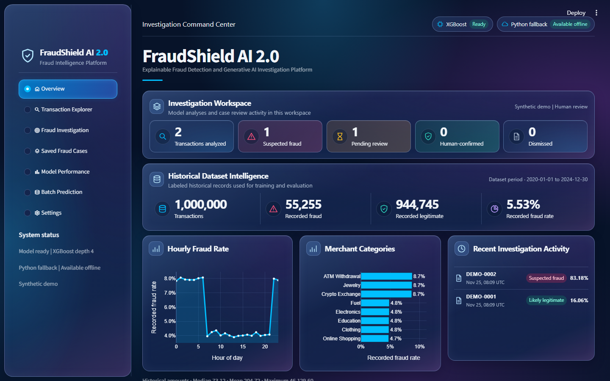
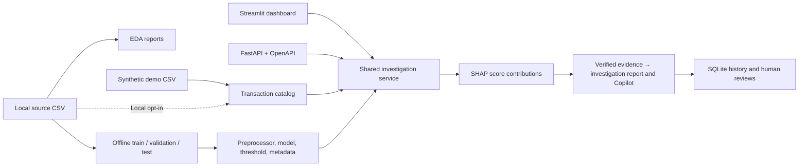

# FraudShield AI

**Intelligent Fraud Detection and AI-Powered Investigation**

FraudShield helps an analyst triage a transaction, understand its model score, and record a human decision with an audit trail. It combines a historical fraud command center, a transaction workspace, signed SHAP evidence, structured investigation reports, and FraudShield Copilot. The included 500 synthetic transactions and pretrained model make the workspace runnable without a private dataset, model training, or an API credential.

The seven Streamlit pages share a glassmorphism design. Overview separates saved analyses in the current workspace from recorded historical outcomes. An empty workspace displays an empty activity panel.



[Mobile overview](reports/screenshots/glass-overview-390.png) · [Fraud investigation](reports/screenshots/glass-investigation-1920.png)

## Architecture



Python, Pandas, and NumPy handle data and features. Scikit-learn and XGBoost fit classifiers. SHAP explains the scores. Plotly, Matplotlib, and Seaborn supply charts. Streamlit and FastAPI use the same Python services and SQLite schema.

## Run locally

Use Python 3.11. From the project directory in PowerShell:

```powershell
python -m venv .venv
.venv/Scripts/python.exe -m pip install -r requirements-dev.txt
.venv/Scripts/python.exe -m streamlit run streamlit_app.py
```

Open `http://localhost:8501`. In **Transaction Explorer**, click a row, then select **Analyze Transaction**. Search for `DEMO-0002` to see a flagged example or `DEMO-0001` to see a likely legitimate one. For a batch demo, download the CSV template from **Batch Prediction** and upload it back. To view the original data locally, set `FRAUDSHIELD_USE_LOCAL_DATA=1` in `.env` and restart. Recorded labels are behind an explicit reveal in the explorer and stay separate from scoring and explanations. Synthetic records have no recorded fraud labels.

The SQLite database defaults to `database/fraudshield.db`. A fresh local session keeps previous results. The public demo gives each browser session a temporary SQLite database, and hosted filesystem state can disappear at restart.

### Contact footer

Set `FRAUDSHIELD_CONTACT_NAME`, `FRAUDSHIELD_CONTACT_EMAIL`, `FRAUDSHIELD_CONTACT_PHONE`, and `FRAUDSHIELD_CONTACT_LINKEDIN` in your local `.env` or in Streamlit Secrets. Enter a full HTTPS LinkedIn profile URL. Configured details are visible to visitors.

### Optional explanations

1. If you do not have an existing `.env`, copy `.env.example` to `.env`.
2. Set `LLM_PROVIDER=groq`, paste your replacement key into `GROQ_API_KEY`, and set `GROQ_MODEL` to a supported model ID. The application checks model availability through Groq's authenticated model list before its first completion. [Groq supported models](https://console.groq.com/docs/models)
3. For Ollama, ensure the local server is running with `qwen3:4b` installed, then select **Local Ollama** in Settings or set `LLM_PROVIDER=ollama`. Configure `OLLAMA_TIMEOUT_SECONDS` for slower local generation. [Ollama chat API](https://docs.ollama.com/api/chat)
4. For offline use, select **Python fallback** or set `LLM_PROVIDER=python`.

Groq `openai/gpt-oss-20b` uses strict JSON Schema. Ollama `qwen3:4b` is optional. The provider receives allowlisted transaction characteristics, model score, threshold, SHAP reference and feature evidence, and relevant training-cohort statistics. The eight-section response schema requires a verified evidence index for every section. The application validates those indices and renders all factual statements and numeric claims from the supplied evidence. Provider errors, invalid references and quota exhaustion fall back to deterministic Python. The process limits provider requests, caches up to 256 responses, and applies configurable timeouts.

### Investigation and Copilot

- **Overview** separates local investigation activity from recorded historical outcomes. The demo never simulates live banking traffic.
- **Explorer** supports ID search, category/payment/device filters, location, amount and retry ranges, sorting, and pagination. Demonstration shortcuts are calculated using the loaded model.
- **Fraud Investigation** shows the model score against the operating threshold, input values, signed SHAP changes, and a waterfall that reconstructs the score. Copilot answers supported questions about the current transaction, such as why it was flagged, which factors matter, and what to verify. It routes a question locally to an approved intent and sends only that intent and approved evidence to the provider. Raw chat text, credentials, IDs, review notes, and history from other cases stay out of provider requests.
- **Saved Fraud Cases** keeps prediction history and human review events. Status changes and notes are saved transactionally. Cases deduplicate by transaction ID and model version. The initial migration records the existing status without inferring earlier review events. Export a case with its review history as JSON or export a filtered page as CSV.
- **Batch Prediction** accepts UTF-8 CSVs up to 2 MB and 1,000 rows. It validates feature fields and file structure, previews the input, and scores in small batches. Reports are requested only when a flagged record is opened. Reports and Copilot for uploads in public sessions use Python.
- **Settings** displays artifact and database status, the active model, and provider connectivity with an explicit connection check.

### Run the API and tests

```powershell
.venv/Scripts/python.exe -m uvicorn api.main:app --host 127.0.0.1 --port 8000 --no-access-log
.venv/Scripts/python.exe -m pytest -q
```

Use `http://localhost:8000/docs` for OpenAPI and interactive request examples. Run tests in a separate terminal. The API is a trusted local interface. Add authenticated reviewer identities and access controls before exposing it to other users.

| Endpoint | Operation |
|---|---|
| `GET /health` | Check model availability |
| `GET /model-info` | Get schema, version, split details, and evaluation |
| `GET /transactions` | Browse with `q`, `international`, `payment`, `minimum`, `offset`, and `limit` |
| `GET /transactions/{transaction_id}` | Get prediction-time transaction details |
| `POST /predict` | Score one feature object |
| `POST /explain` | Analyze and save a catalog ID supplied as `{"transaction_id":"DEMO-0001"}` |
| `POST /predict-batch` | Score an array of up to 1,000 feature objects |
| `GET /investigations` | Browse cases by ID substring and status |
| `PATCH /investigations/{case_id}` | Set a review status with `{"status":"Under investigation"}` |

## Executed results

The training source is **Bank Transaction Fraud Detection Dataset**, published by **Nafiul Islam** on Kaggle under **CC0 1.0 Universal**. FraudShield uses it for offline exploration, chronological customer-disjoint training, training-only feature transformation, and evaluation. The shipped XGBoost artifact is the original trained version, and the browser demo uses a separate synthetic file. [Original Kaggle source](https://www.kaggle.com/datasets/nafiulislam490/bank-transaction-fraud-detection-dataset?resource=download) · [Dataset and model provenance](DATASET.md)

The source contains **1,000,000 transactions**, **55,255 recorded fraud cases (5.53%)**, and **198,662 customers**. The audit found zero duplicate rows, transaction ID duplicates, and hour mismatches. All 944,745 missing values are in `fraud_type`, whose presence exactly identifies the target.

| Validation candidate | Avg. precision | ROC AUC | Precision | Recall | F1 |
|---|---:|---:|---:|---:|---:|
| Dummy | .0565 | .5000 | .0565 | 1.0000 | .1070 |
| Logistic Regression | .1294 | .7211 | .1394 | .3808 | .2041 |
| Random Forest | .1292 | .7204 | .1562 | .3368 | .2134 |
| XGBoost depth 2 | .1319 | .7245 | .1371 | .4609 | .2113 |
| **XGBoost depth 4** | **.1323** | .7212 | .1411 | .4181 | .2109 |

Selection used validation average precision, with threshold chosen by validation F1. The depth-4 and depth-2 AP values were very close. On **32,465 held-out transactions**, XGBoost depth 4 achieved **.1292 AP**, **.7255 ROC AUC**, **82.21% accuracy**, **13.25% precision**, **40.21% recall**, and **.1994 F1** at a **.64015** threshold. It flagged 719 recorded fraud cases and 4,706 recorded legitimate cases, missed 1,069 recorded fraud cases, and left 25,971 legitimate cases below threshold. False-positive and false-negative rates were **15.34%** and **59.79%**. On the development run the selected fit took **2.06 s**, and scoring the already-transformed held-out matrix took **0.054 s**, excluding preprocessing and explanation.

### 2.0 model experiment

The offline experiment fit on 220,000 earlier rows, calibrated on 5,131 customer-disjoint rows, and ranked candidates on 9,585 later development rows. XGBoost, LightGBM, CatBoost, Random Forest, Logistic Regression, HistGradientBoosting and a dummy baseline were compared. The active model achieved **.14163 AP** on the selection partition, ahead of Random Forest (**.14010**) and LightGBM (**.13957**). The active artifact and threshold were retained. The original holdout was reserved, so the earlier held-out figures above remain the only held-out evaluation.

The report includes calibrated and uncalibrated Brier diagnostics, weighted and unweighted fits, and F1, F2, minimum 10% recall precision, and illustrative cost thresholds. The cost experiment assumes one unit per false positive and ten per false negative. These are scenario units, with no claim of actual monetary costs. [Experiment results](reports/experiment-v2.json) · [Model card](MODEL_CARD.md)

```powershell
.venv/Scripts/python.exe -m pip install -r requirements-experiments.txt
.venv/Scripts/python.exe -m fraudshield.experiment
.venv/Scripts/python.exe -m fraudshield.intelligence
```

### EDA findings

- International transactions with at least two failed attempts recorded fraud in **19.39%** of cases (2,907 / 14,990). The corresponding domestic group had **13.75%** (11,687 / 85,011).
- The group with at least two failed attempts and an interval of 30 minutes or less recorded **18.73%** fraud (780 / 4,165). The repeated-failure group with longer intervals recorded **14.41%**.
- The upper IQR fence for amount was **403.525**. Above-fence observations recorded **6.02%** fraud, versus **5.46%** among the remaining observations. With international activity and repeated failures, the corresponding rates were **20.81%** and **19.20%**.
- Fraud amounts exceeded legitimate amounts in an estimated **50.98%** of pairs with half credit for ties. The Mann–Whitney p-value was approximately **9.82 × 10⁻¹⁵**, alongside a small effect. International status had a strong unadjusted association (χ² **6,339.49**). These comparisons are descriptive and do not establish causality or account for within-customer dependence.

See [source audit](reports/eda.json), [correlation matrix](reports/correlation.csv), and [visualizations](reports/visualizations/) for counts, class comparisons, and plots.

### Reproduce the model

Place the original dataset at `Dataset/bank_fraud.csv`.

```powershell
.venv/Scripts/python.exe -m fraudshield.eda
.venv/Scripts/python.exe -m fraudshield.train
```

The original `data.ipynb` is retained locally. It already analyzed class balance, hourly patterns, payment methods, failures, international status, amount, distance, account age, and activity intervals. The reproducible audit extends those analyses.

The CSV uses day-first dates. Chronological cutoffs were March 31, 2023 and February 5, 2024. Chronology alone shared 109,993 train/validation customers, 114,253 train/test customers, and 67,947 validation/test customers. Independent customer hashing within each time window removed overlap, retaining 421,935 / 28,950 / 32,465 rows. A seeded 100,000-row training sample bounded CPU work. Scaling and category encoding fit that sample, and weights addressed class imbalance for the learned models.

Transaction ID and customer ID are only used for lookup and split isolation. The model excludes raw date/time, geographic text, demographics, account aggregates, transaction counts, and supplied night/weekend flags. The hour is independently consistent with the transaction timestamp. Merchant, payment channel, device, amount, and hour must be available at scoring. International, failed attempts, time since last transaction, and recent PIN change must be available as event-time snapshots. The source does not document their computation. In production, verify that they exclude future events or post-authorization results. Engineered interactions depend only on the allowed features.

Permutation SHAP explains the class-1 score on its original 0–1 scale using 64 synthetic reference records. The reference plus signed contributions reconstructs each explained score. Global importance summarizes 128 held-out records. Contributions describe the model and can be shared across correlated inputs.

## Publish to GitHub

Publication requires the owner's approval and confirmation of redistribution rights for the trained model, source-derived reports, and screenshots. [RELEASE_FILES.txt](RELEASE_FILES.txt) lists the intended files. The raw CSV, original notebook, supplied design reference, secrets, SQLite files, and recovery archives stay local. Load joblib artifacts only from a trusted checkout.

After clearance and approval, create an empty GitHub repository without starter files. Run these commands from this project directory for a new Git repository:

```powershell
git init -b main
git add --pathspec-from-file=RELEASE_FILES.txt
$expected = Get-Content RELEASE_FILES.txt | Sort-Object
$staged = git ls-files | Sort-Object
if (Compare-Object $expected $staged) { throw "Staged files differ from the release manifest" }
git diff --cached --stat
git commit -m "Release FraudShield AI"
git remote add origin https://github.com/YOUR-ACCOUNT/fraudshield-ai.git
git push -u origin main
```

Replace `YOUR-ACCOUNT` before adding the remote. If using an existing repository, audit its history and tracked files before any push. Ignore rules apply to untracked files and do not remove files from prior commits. [GitHub guidance on adding files securely](https://docs.github.com/en/repositories/working-with-files/managing-files/adding-a-file-to-a-repository)

## Deploy to Streamlit Community Cloud

1. After the approved GitHub release, select **Create app** in Streamlit Community Cloud. Set the repository to `YOUR-ACCOUNT/fraudshield-ai`, branch to `main`, and entry point to `streamlit_app.py`. Under **Advanced settings**, select **Python 3.11**. The root `requirements.txt` includes runtime dependencies. [Streamlit deployment guide](https://docs.streamlit.io/deploy/streamlit-community-cloud/deploy-your-app/deploy)
2. Enter these TOML settings in **Secrets** and save. [Streamlit secrets guide](https://docs.streamlit.io/deploy/streamlit-community-cloud/deploy-your-app/secrets-management)

```toml
FRAUDSHIELD_PUBLIC_DEMO = "1"
FRAUDSHIELD_USE_LOCAL_DATA = "0"
LLM_PROVIDER = "python"
```

3. Select **Deploy**, then open the public URL in two independent browser sessions. Verify both demo investigations, isolated case history, a review with notes, and CSV upload within the 2 MB and 1,000-row limits.
4. For optional Groq, change `LLM_PROVIDER` to `"groq"` and add `GROQ_MODEL = "openai/gpt-oss-20b"`, `GROQ_API_KEY` with a fresh owner credential, and `LLM_REQUESTS_PER_MINUTE = "5"` in Cloud Secrets. The limit is per running process. Keep the initial public release on Python if you want to avoid external provider calls entirely.

Public mode forces the synthetic catalog, creates a separate temporary SQLite database per Streamlit session and disables shared FastAPI data routes. Use the FastAPI process on a trusted local interface. Authentication, durable shared storage, reviewer identity, production privacy controls, and monitoring require a separate production design. Streamlit runtime dependencies are pinned in `requirements.txt`. Optional research libraries are pinned separately to keep the hosted installation lean.

## Limitations and next steps

This is a portfolio demonstration for human review. Weighted classifier scores are uncalibrated, most alerts on the held-out data were false positives, and the test represents an internal source with substantial row exclusions from the strict split. Feature semantics and event availability require validation before applying the model to financial operations. The original notebook had already explored the full source, so the strict holdout protects model fitting and threshold selection but cannot erase prior dataset-wide exploration. Future work includes independent temporal validation, calibration, capacity-based threshold selection, subgroup and drift monitoring, and authenticated persistent review storage.

## Layout

```text
data.ipynb                      Original EDA, local and ignored by Git
Dataset/bank_fraud.csv           Local source, ignored by Git
data/demo.csv                    Synthetic recruiter transactions
fraudshield/                    EDA, training, scoring, explanations, storage
models/                         Trusted model bundle and evaluation metadata
reports/                        EDA summaries, correlations, and plots
api/                            FastAPI routes and schemas
streamlit_app.py                Python dashboard entry point
.streamlit/config.toml          Dashboard theme and upload settings
database/                       Local SQLite files created at runtime
tests/                          Unit and integration tests
RELEASE_FILES.txt               Exact intended publication file list
```
